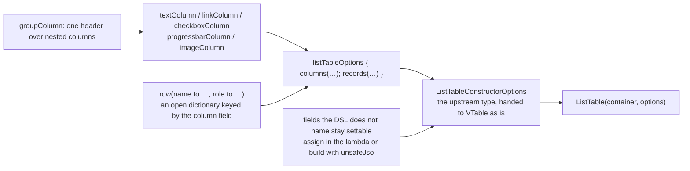

# List table

`ListTable` lays out flat records in columns. The wrapper keeps the upstream
`ListTableConstructorOptions` type and adds a DSL for the parts that are tedious to write by hand.

## Options

```kotlin
val options = listTableOptions {
    columns(
        textColumn("name", "Name", 150.0),
        textColumn("role", "Role", 160.0),
    )
    records(
        row("name" to "Ada", "role" to "Analytical engine"),
    )
    frozenColCount = 1.0
    widthMode = StandardOrAdaptiveOrAutoWidths.adaptive
}
```

`listTableOptions { }` builds an upstream `ListTableConstructorOptions`; every field the package
declares is available inside the lambda, including the ones the DSL does not touch (`hover`,
`keyboardOptions`, `excelOptions`, `customRender`, …). Options the DSL does add:

| Helper | Upstream field | Notes |
| --- | --- | --- |
| `columns(vararg ColumnDefine)` | `columns` | takes the column objects `textColumn` / `groupColumn` return |
| `records(vararg Any)` | `records` | takes `row(...)` objects |
| `row(vararg Pair<String, Any?>)` | one record | keys are column `field` names |




## Columns

`textColumn`, `linkColumn`, `checkboxColumn`, `progressbarColumn` and `imageColumn` all take
`(field, title, width)` and an optional configuration block:

```kotlin
textColumn("role", "Role", 160.0) {
    editor = "input".unsafeCast<JsAny>()   // an editor registered by name
    showSort = true
    style = unsafeJso<ITextStyleOption> { textAlign = TextAlign.center }
}
```

The block is typed as `ColumnSpec`, which declares the fields the demo and the documentation use:
`field`, `title`, `width`, `cellType`, `style`, `headerStyle`, `editor`, `headerEditor`, `sort`,
`showSort` and the nested `columns` of a group. For a field outside that list, build the column from
the generated declaration instead:

```kotlin
val column: ColumnDefine = unsafeJso<TextColumnDefine> {
    field = "role".unsafeCast<FieldDef>()
    title = "Role".unsafeCast<StringOrString2>()
    // …
}
```

## Grouped headers

`groupColumn` nests columns under one header cell:

```kotlin
columns(
    textColumn("name", "Name", 130.0),
    groupColumn(
        "2025 H1",
        textColumn("q1", "Q1", 90.0),
        textColumn("q2", "Q2", 90.0),
    ),
)
```

## Rows

`row` takes pairs and builds a plain JavaScript object, so a record only needs the fields its columns
read:

```kotlin
row("name" to "Ada Lovelace", "score" to 96.0)
```

The values are written as they are: strings, numbers, booleans, dates and nested objects all pass
through. Missing keys read as empty cells; extra keys are ignored.

## Escape hatch

Nothing is hidden: the generated declarations are the full upstream surface, so any option can be set
directly, and `unsafeJso<ListTableConstructorOptions>` is always available when a field's type is a
union the DSL does not wrap.

## Next

- [Pivot table](guide/pivot-table.md) — the same records, aggregated by dimensions.
- [Themes and editors](guide/themes-and-editors.md) — styling and editable cells.
