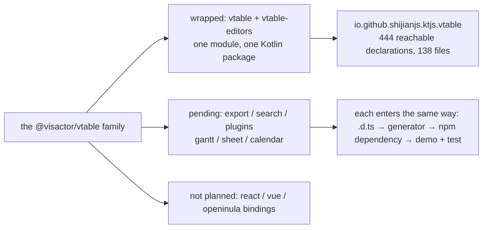

# Package coverage

The scope is "the open-source packages of VTable", not a selection of features. This page is the
checklist; the live version with per-item details is
[`docs/development/api-coverage.md`](https://github.com/shijianjs/ktjs-vtable/blob/main/docs/development/api-coverage.md).

## Wrapped

| Package | Kotlin home | Notes |
| --- | --- | --- |
| `@visactor/vtable` | `io.github.shijianjs.ktjs.vtable` | `ListTable`, `PivotTable`, `PivotChart`, events, themes, `register`. 444 reachable declarations, 138 files |
| `@visactor/vtable-editors` | same package | `InputEditor`, `TextAreaEditor`, `DatePickerEditor`; imports the package root because upstream exports only `.` |

Both packages share one Gradle module and one Kotlin package: they share an upstream version and a
release cadence, so splitting them would only add a Maven version per release.

## Pending

| Package | Why it is pending |
| --- | --- |
| `@visactor/vtable-export` | needs the generator extended with a second npm dependency plus a browser-driven test for the produced file |
| `@visactor/vtable-search` | same generation step; the search panel mounts its own DOM, so it also needs a demo page |
| `@visactor/vtable-plugins` | plugin options reach into VChart and VRender types; the generator has to resolve those first |
| `@visactor/vtable-gantt` | large options surface, and its own layout types are not exported from a single entry |
| `@visactor/vtable-sheet` | same as Gantt |
| `@visactor/vtable-calendar` | same as Gantt |

Each pending package enters the repository the same way the editors package did: add its `.d.ts`
directory to the generator invocation, add the npm dependency, regenerate, then write a demo and a
test.

## Not planned

| Package | Reason |
| --- | --- |
| `@visactor/react-vtable` | a React component; Kotlin/JS callers construct the table directly |
| `@visactor/vue-vtable` | Vue binding, same reason |
| `@visactor/openinula-vtable` | OpenInula binding, same reason |

These are framework bindings rather than tables: wrapping them would produce declarations that no
Kotlin/JS application can use without pulling in the corresponding framework.
