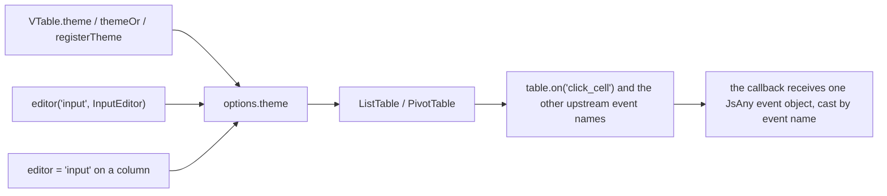

# Themes and editors




## Themes

A theme is a set of design tokens applied to the whole table. The upstream package ships five named
themes — `DEFAULT`, `DARK`, `BRIGHT`, `ARCO`, `SIMPLIFY` — and the wrapper's `VTable` object resolves
them by name:

```kotlin
val options = listTableOptions {
    columns(textColumn("name", "Name", 150.0))
    records(row("name" to "Ada"))
    theme = VTable.themeOr("dark").unsafeCast<ITableThemeDefine>()
}
```

| Member | Behaviour |
| --- | --- |
| `VTable.theme(name)` | `of(name)`, which resolves a registered name or an already-built theme; `null` when nothing matches |
| `VTable.themeOr(name)` | the same, falling back to `DEFAULT` |
| `VTable.registerTheme(name, theme)` | registers a theme so later tables can use it by name |

The generated `DARK`, `BRIGHT`, `ARCO`, `SIMPLIFY` and `DEFAULT` values are the upstream constants and
can be used directly.

## Editors

Cell editors come from `@visactor/vtable-editors`, wrapped in the same module. Register one by name and
then reference that name from a column:

```kotlin
editor("input", InputEditor(null).unsafeCast<IEditor>())

val options = listTableOptions {
    columns(
        textColumn("name", "Name", 150.0),
        textColumn("role", "Role", 160.0) {
            editor = "input".unsafeCast<JsAny>()
        },
    )
}
```

`InputEditor`, `TextAreaEditor` and `DatePickerEditor` are the three upstream editors; their
constructors take an optional configuration object (`InputEditorConfig`, …). An editor is a plain
upstream object — the wrapper only gives its class and its configuration a Kotlin type.

## Events

Table events are properties whose names are upstream event strings. The callback receives one
`JsAny` argument — the event object, whose shape depends on the event name:

```kotlin
val table = ListTable(container, options)
table.on("click_cell".unsafeCast<JsAny>()) { args ->
    val cell = args.unsafeCast<ClickedCell>()   // { row: number, col: number, … }
    println("row ${cell.row}, col ${cell.col}")
    null.unsafeCast<JsAny>()                    // the callback's return value is ignored
}
```

`on` is declared as `(JsAny, TableEventListener) -> EventListenerId`, so it is called like a function.
The names to use are the upstream ones (`click_cell`, `dblclick_cell`, `mouseenter_cell`,
`selected_cell`, …); the generated `TableEvents` interface lists them with their argument types.

## Next

- [Development](guide/development.md) — regenerate the declarations, run the checks.
- [Package coverage](guide/scope.md) — the state of every upstream package.
