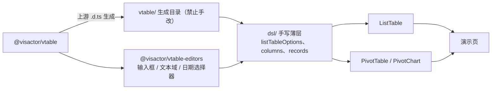

# Introduction

`ktjs-vtable` 是 [VisActor VTable](https://github.com/VisActor/VTable) 开源部分的 Kotlin/JS 封装。
VTable 是一套画在 canvas 上的表格库，发布为 `@visactor/vtable`。声明由上游自己的 `.d.ts` 生成，日常
构造表格、列、数据行的用法由一层很薄的手写 DSL 兜住。

[在线演示](https://shijianjs.github.io/ktjs-vtable/demo/) ·
[API 文档](https://shijianjs.github.io/ktjs-vtable/api/) ·
[源码](https://github.com/shijianjs/ktjs-vtable)

## 封装范围

| 上游包 | 内容 | 状态 |
| --- | --- | --- |
| `@visactor/vtable` | `ListTable`、`PivotTable`、`PivotChart`、事件、主题、`register` 命名空间 | 已封装 |
| `@visactor/vtable-editors` | 输入框、文本域、日期选择器三种单元格编辑器 | 已封装 |
| `@visactor/vtable-export` | CSV / Excel 导出 | 待完成 |
| `@visactor/vtable-search` | 表内搜索 | 待完成 |
| `@visactor/vtable-plugins` | 选区、右键菜单等插件 | 待完成 |
| `@visactor/vtable-gantt` | 甘特视图 | 待完成 |
| `@visactor/vtable-sheet` | 电子表格视图 | 待完成 |
| `@visactor/vtable-calendar` | 日历视图 | 待完成 |
| `@visactor/react-vtable`、`-vue-vtable`、`-openinula-vtable` | 框架绑定 | 明确不做 |

框架绑定不做，因为 Kotlin/JS 用不上 React / Vue / OpenInula 组件——Kotlin 调用方直接构造表格。待完成的
包按状态列在 [包覆盖](guide/scope.md) 里，那张表是权威清单。

封装发布的东西全是 MIT：VTable 本身是 MIT，封装只多了声明和一层薄 DSL，运行时的代码来自上游包。

## 仓库结构

| 模块 | 作用 |
| --- | --- |
| `ktjs-vtable` | 发布的模块：生成的声明 + 手写 DSL |
| `demo` | 演示页，发布在 Pages 的 `/demo/` |
| `docs` | 本文档站，由 ktjs-docusaurus 构建的 Kotlin/JS 模块 |

`ktjs-vtable/src/jsMain/kotlin/io/github/shijianjs/ktjs/vtable/` 是生成目录，禁止手改；旁边的 `dsl`
子包是手写的，生成器不会碰。怎么重新生成见 [开发](guide/development.md)。

生成目录与手写层是同一棵树里的两个子包，边界由生成器守着：重新生成只覆盖 `vtable/`，`dsl/` 不会被碰。

## 版本约定

每个模块的版本是 `{上游 npm 版本}-kt.{修订号}`：上游版本只在根 `package.json` 里声明，修订号在
`wrapper-revisions.properties` 里维护。工作树里的版本一律再带 `-SNAPSHOT`，开发构建不会冒用下一个要发的版本。

## 接下来

- [快速开始](guide/getting-started.md) — 装依赖，建第一张表。
- [列表](guide/list-table.md) — 列、数据行、分组表头。
- [透视表](guide/pivot-table.md) — 维度与指标。
- [主题与编辑器](guide/themes-and-editors.md) — 主题、单元格编辑器、事件。
