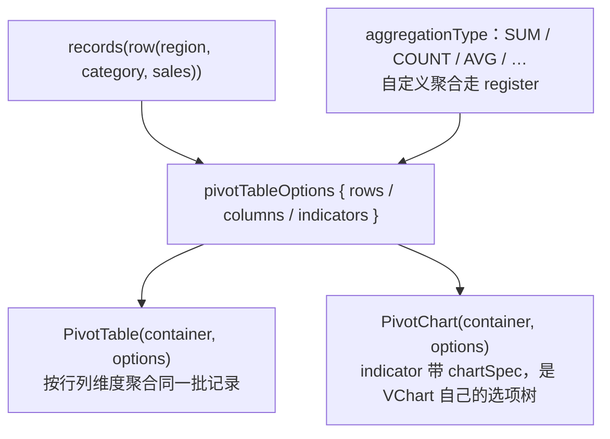

# 透视表

`PivotTable` 把同一批平坦记录按行、列维度聚合。它的选项类型是 `PivotTableConstructorOptions`，
`pivotTableOptions { }` 的用法与 `listTableOptions` 一致。




## 维度与指标

```kotlin
val options = pivotTableOptions {
    records(
        row("region" to "华东", "category" to "A", "sales" to 120.0),
        row("region" to "西部", "category" to "A", "sales" to 150.0),
    )
    this.rows = arrayOf<JsAny>(unsafeJso<PivotDimension> { field = "region"; title = "区域" })
    this.columns = arrayOf<JsAny>(unsafeJso<PivotDimension> { field = "category"; title = "类别" })
    this.indicators = arrayOf<JsAny>(
        unsafeJso<PivotIndicator> { field = "sales"; title = "销售额"; aggregationType = "SUM" },
    )
    widthMode = StandardOrAdaptiveOrAutoWidths.standard
}
PivotTable(container, options)
```

- `rows` / `columns` 在上游是 `Array<JsAny>`（`(IRowDimension | string)[]`），封装按 JS 对象透传；
  用到的形状自己声明即可，如上。
- `indicators` 负责聚合：`aggregationType` 是上游聚合器注册表认识的字符串（`SUM`、`COUNT`、`AVG` …）。
  自定义聚合器通过 `register` 注册，见 [主题与编辑器](guide/themes-and-editors.md)。
- `records` 同样接收 `row(...)` 造出来的行，和列表一模一样。

## 透视图表

`PivotChart` 接收 `PivotChartConstructorOptions`，在单元格里画图。它的指标是图表指标：每个指标带一份
`chartSpec`，所以选项用 `pivotChartOptions { }` 构造，指标对象来自生成的声明——DSL 刻意没有为它发明
形状，因为 chart spec 就是 VChart 自己的选项树。

## 透视表不做什么

封装不重新实现任何聚合或布局逻辑：`PivotTable` 与 `PivotChart` 就是上游的类，只是用有类型的选项构造。
某个上游选项在 DSL 里够不到时，直接在选项对象上赋值。

## 接下来

- [主题与编辑器](guide/themes-and-editors.md) — 两张表的外观从哪来，单元格怎么变成可编辑的。
- [包覆盖](guide/scope.md) — 现在已经封装了什么，还差什么。
